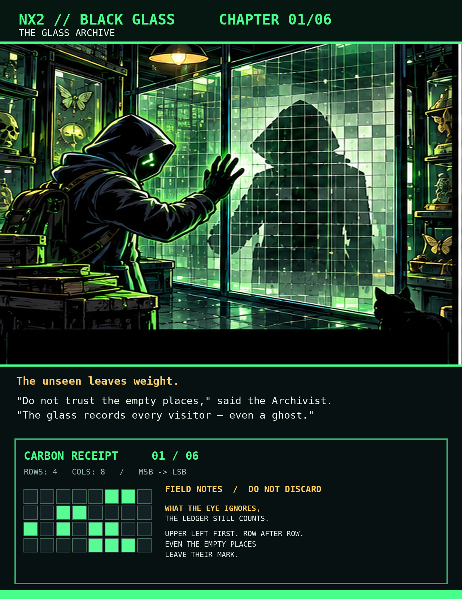
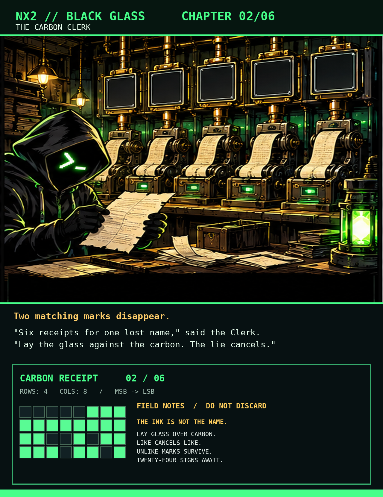
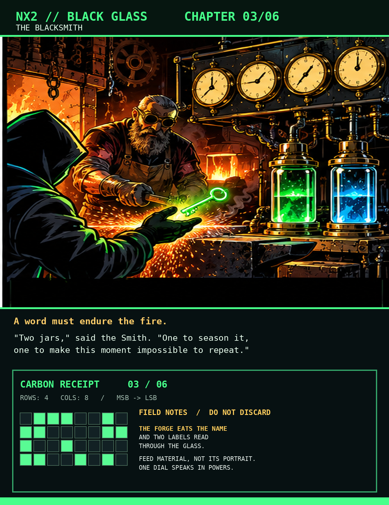
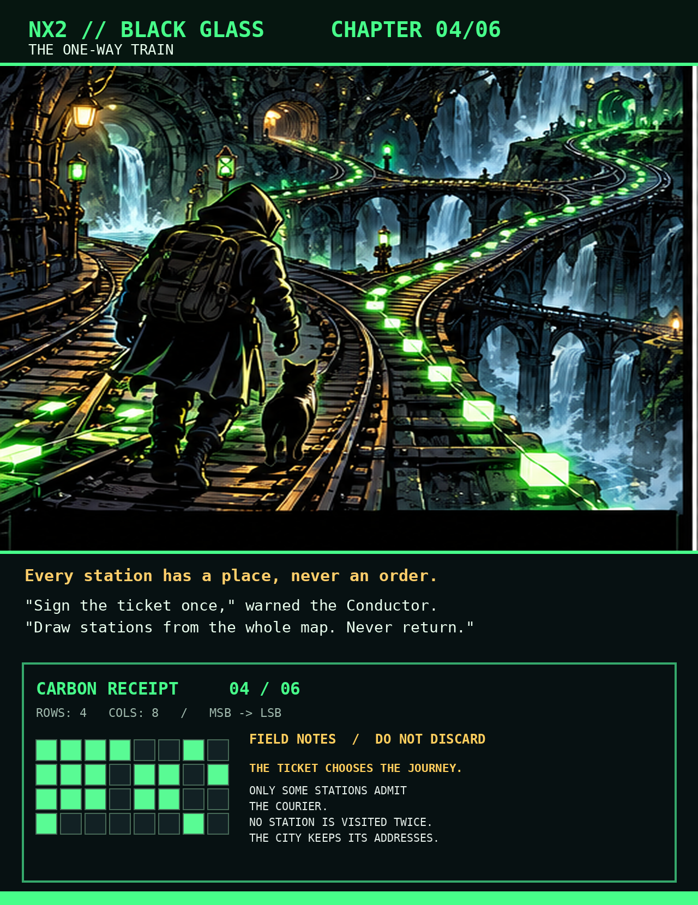
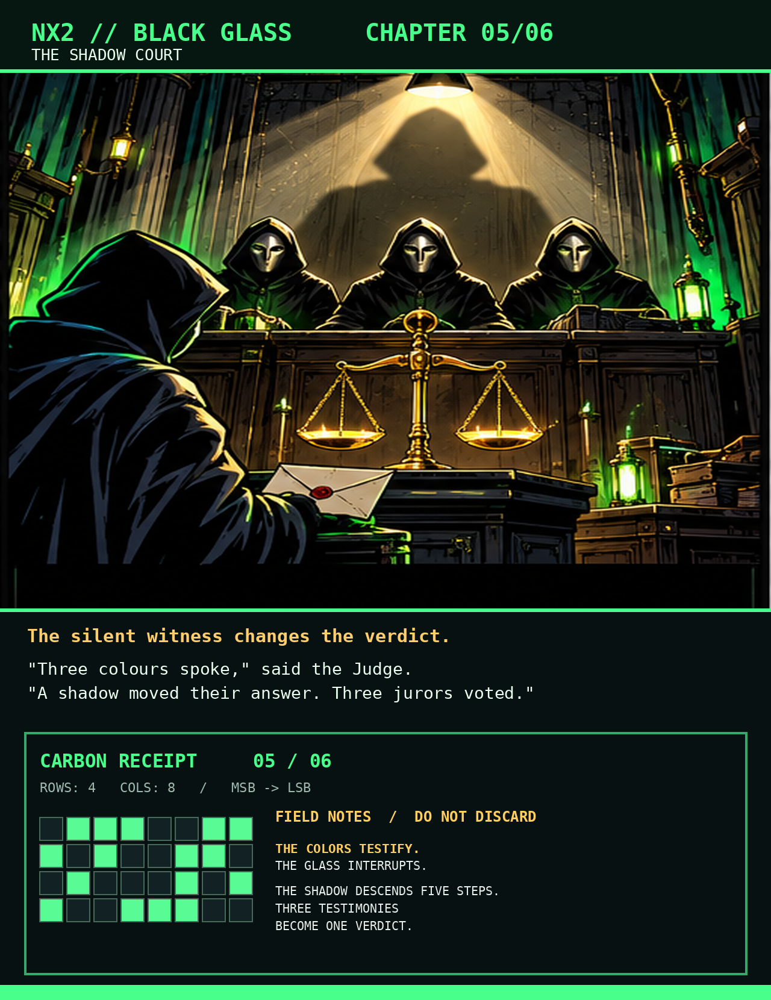
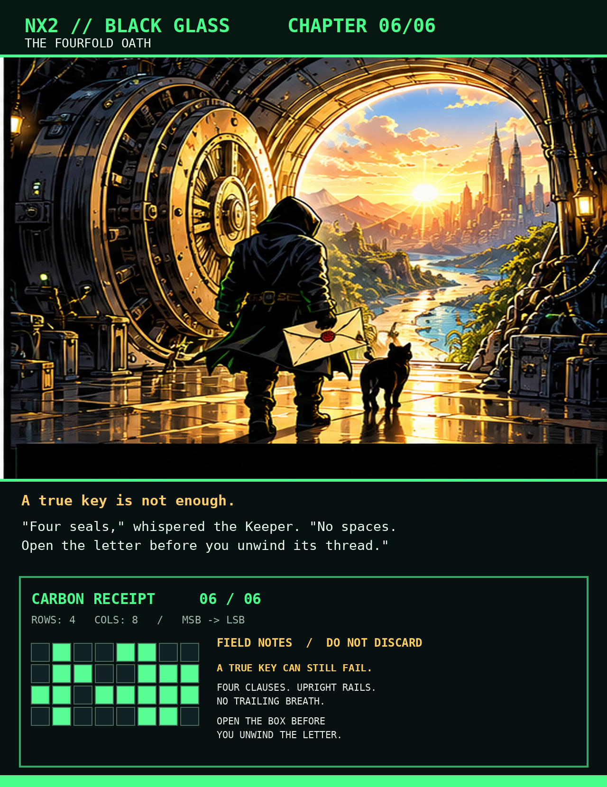

```text
  _   _ __  ______
 | \ | |\ \/ /___ \
 |  \| | \  /  __) |
 | |\  | /  \ / __/
 |_| \_|/_/\_\_____|

  >_ BLACK GLASS                                  [SEALED]
  --------------------------------------------------------
  SIX DOORS. ONE COURIER. ONE LETTER WITHOUT A SENDER.
```

<h1 align="center">NX2 // BLACK GLASS</h1>

<p align="center">
  <strong>A cryptographic mystery in six illustrated chapters.</strong><br>
  <code>FORENSICS</code> · <code>STEGANOGRAPHY</code> · <code>CRYPTOGRAPHY</code><br>
  <sub>HARD EDITION &nbsp; / &nbsp; OFFLINE &nbsp; / &nbsp; ONE AUTHENTICATED ANSWER</sub>
</p>

<p align="center">
  <a href="#01--the-glass-archive">01</a> &nbsp;·&nbsp;
  <a href="#02--the-carbon-clerk">02</a> &nbsp;·&nbsp;
  <a href="#03--the-blacksmith">03</a> &nbsp;·&nbsp;
  <a href="#04--the-one-way-train">04</a> &nbsp;·&nbsp;
  <a href="#05--the-shadow-court">05</a> &nbsp;·&nbsp;
  <a href="#06--the-fourfold-oath">06</a>
</p>

---

> **THE ASSIGNMENT** — Find the letter inside [`avatar.png`](avatar.png), open it, and prove that it has not been altered. The pictures tell a story. The story has rules. The receipts carry evidence that no amount of guessing can replace.

No secret website, earlier release, private password, or brute-force search is necessary. Work from the **original PNGs**; a screenshot is not the glass.

<a id="01--the-glass-archive"></a>

## 01 / The Glass Archive

<p align="center">
  <a href="frames/01_the_glass_archive.png"></a>
</p>

The Archivist guarded a wall four hundred panes wide and four hundred tall. Each pane held four layers of light: red, green, blue, and the weight of what could not be seen. The last layer had a name — *alpha*. Some panes carried none of it at all, but she never struck those places from her ledger.

She counted from the upper-left corner, along each row before descending to the next. Not the colors, not an artist's impression: just the **one-byte weight** of every pane, exactly as the glass held it. When all 160,000 had passed under her finger, she pressed them through a seal stamped *SHA / 256*.

The seal was thirty-two bytes long. She kept the metal impression, not its hexadecimal portrait. It would accompany the courier through every remaining door.

> *“An empty square is still a square. What the eye forgets, the glass remembers.”*

<p align="right"><sub><a href="frames/01_the_glass_archive.png">VIEW ORIGINAL EVIDENCE ↗</a> · 01/06</sub></p>

---

<a id="02--the-carbon-clerk"></a>

## 02 / The Carbon Clerk

<p align="center">
  <a href="frames/02_the_carbon_clerk.png"></a>
</p>

The Carbon Clerk had been collecting copies of a lost name for years. Six slips lay on his desk, each arranged in four lines of eight squares. They were numbered as chapters, not dates. Bright ink meant a mark; darkness meant its absence. The leftmost square of a line had always been the most significant.

“Twenty-four characters,” he told the courier, “but not a single one is written directly.” He took the slips in the order of the journey, read each line from left to right, and laid the resulting twenty-four bytes against the **first twenty-four unpainted bytes** of the Archivist's seal.

Where two marks agreed, both vanished. Where they differed, one survived. The Clerk called it the law of *either, never both*. The surviving signs were ordinary ASCII, a name the forge would recognize.

> *“A carbon copy is a lie until the glass is placed over it.”*

<p align="right"><sub><a href="frames/02_the_carbon_clerk.png">VIEW ORIGINAL EVIDENCE ↗</a> · 02/06</sub></p>

---

<a id="03--the-blacksmith"></a>

## 03 / The Blacksmith

<p align="center">
  <a href="frames/03_the_blacksmith.png"></a>
</p>

At the forge, the lost name was not enough. Two small vessels stood behind smoke-dark glass; their labels faced inward. In the reflection the courier could read **TLAS** and **ECNON**. The Smith insisted on their true names in capitals, each enclosed between a pair of upright rails. No space belonged between a rail and a name.

Into each vessel went the Archivist's **raw seal**, immediately followed by its own railed name. The same 256-toothed seal pressed each mixture anew. From the left edge of the first result the Smith filled a **sixteen-byte** vial; the second held **twelve**. One would season the forge, the other would preserve a moment that must never happen twice.

Over the anvil hung a battered plate reading **S–CRYPT**. Four dials sat beneath it: the first, **N**, bore fourteen *doubling* marks; **r** bore eight; **p** only one; and **dk** counted thirty-two teeth on the key to be forged. The Smith fed the recovered name and the seasoning vial into the machine, not the name's painted hexadecimal likeness.

> *“The vessel keeps its measure. The key keeps the work it cost.”*

<p align="right"><sub><a href="frames/03_the_blacksmith.png">VIEW ORIGINAL EVIDENCE ↗</a> · 03/06</sub></p>

---

<a id="04--the-one-way-train"></a>

## 04 / The One-Way Train

<p align="center">
  <a href="frames/04_the_one-way_train.png"></a>
</p>

The Conductor refused to print a route. Instead he signed one ticket with the Smith's finished key. The message he signed was the Archivist's **raw seal** followed immediately by the road's name, in capitals between two upright rails: **PIXEL_WALK**. The signing office carried the old insignia **HMAC / SHA-256**. Only the **left sixteen bytes** of the signature became the ticket number, read with its most significant end first.

At the engine shed a brass manufacturer's plate read **NumPy 2.3.5**. Two levers had survived the rust: `default_rng`, which accepted the ticket number, and `choice`, which drew the stations. The Conductor took a **single ordered draw without replacement**. He never shuffled the city before taking its first stops, nor sorted the stops afterward.

Every square of the original glass had an address, including those trains could never reach. The admission gate accepted only squares whose alpha weight was at least **A0 in hexadecimal**. Even after the rejection, an address still meant its position in the full four-hundred-by-four-hundred city.

The freight ledger recorded **78₁₆ bytes** inside the arriving crate. Each byte needed eight verdicts, and every verdict required three hearings. That was the number of stations on the ticket.

For inspection, the first twelve visited addresses were written as **four-byte, high-end-first integers** before being sealed with SHA-256. The Conductor kept their order, not a sorted register.

> *“A station has an address, never a promise to be visited.”*

<p align="right"><sub><a href="frames/04_the_one-way_train.png">VIEW ORIGINAL EVIDENCE ↗</a> · 04/06</sub></p>

---

<a id="05--the-shadow-court"></a>

## 05 / The Shadow Court

<p align="center">
  <a href="frames/05_the_shadow_court.png"></a>
</p>

At every station the courier collected a testimony. Red, green, and blue each offered no more than their **lowest bit**. The Court did not add these three voices; it heard them under the Clerk's ancient law of *either, never both*.

But the glass had its own witness. Its alpha weight moved **five binary places to the right**, and only the lowest surviving bit was allowed to speak. That shadow, too, could overturn the colors' combined testimony under the very same exclusive law.

The judges considered the resulting voices **three at a time, in the order the train had visited them**. Agreement by at least two made a verdict of one; otherwise the verdict was zero. The scribe assembled each eight verdicts into a byte, beginning with the most significant bit.

It was only after the last hearing that the crate became legible.

> *“Three colors make a witness. Three witnesses make a verdict.”*

<p align="right"><sub><a href="frames/05_the_shadow_court.png">VIEW ORIGINAL EVIDENCE ↗</a> · 05/06</sub></p>

---

<a id="06--the-fourfold-oath"></a>

## 06 / The Fourfold Oath

<p align="center">
  <a href="frames/06_the_fourfold_oath.png"></a>
</p>

The Keeper examined the recovered crate. Its first **four bytes** carried a badge — **NX2!** — followed by a **two-byte count** written most-significant end first. The count measured only what was *sealed*, including the seal's own authentication tag. Then came the **first eight bytes** of a SHA-256 memory of the letter as it would read **after** it was fully opened and unwound. Everything beyond those fourteen opening bytes was locked cargo.

The lock was an old **ChaCha20–Poly1305** mechanism. The Smith's key fitted it, and the twelve-byte vessel protected its one-time turn. But a correct key was not enough: the Keeper also demanded four spoken seals as unencrypted, authenticated **ASCII**. The first was the badge with its exclamation silenced. The second measured the glass in the form *widthxheight*, with a small **x**. The third was the Court's uppercase carving, **RGBASHADOW5**. The fourth was the judges' verdict, **TRIVOTE**.

She separated the four clauses with one upright rail each — `|` — allowing **no spaces and no final newline**. Those exact words were never placed inside the encrypted letter; they bound the lock to the story that had brought it here.

Beyond the gate, the courier found the letter wound tightly like a spring. The Keeper pointed to the final inscription: **zlib**. First the authenticated lock must open; only then could the coiled words be released, and only then could the crate's eight-byte memory be checked against the restored letter.

> *“The truth is not merely a key. It is a key, an oath, and a letter that survives both.”*

<p align="right"><sub><a href="frames/06_the_fourfold_oath.png">VIEW ORIGINAL EVIDENCE ↗</a> · 06/06</sub></p>

---

## Evidence locker

- **[avatar.png](avatar.png)** — the original carrier. Preserve its pixels and alpha channel.
- **[Inspector's scraps](SCRAPS.md)** — a damaged notebook, filed out of order.

<details>
<summary><strong>OPTIONAL // Break the seal if you need a nudge</strong></summary>

- [Checkpoints](CHECKPOINTS.md) — abbreviated commitments for verifying intermediate evidence.
- [File checksums](SHA256SUMS.txt) — verify intact downloads.

</details>

> [!IMPORTANT]
> A readable guess is not a solution. The letter must pass authentication **and** its final integrity check. Please do not post the message in public issues without a spoiler warning.

```text
  [ EOF ]   THE GLASS REMEMBERS WHAT THE CITY FORGOT.   >_
```
